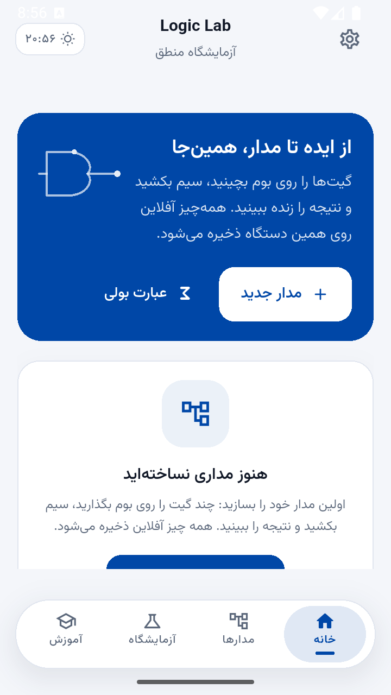
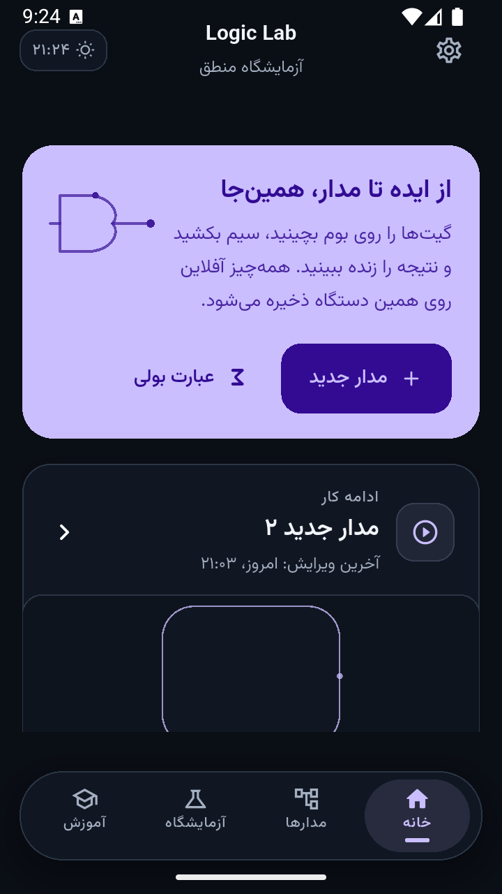
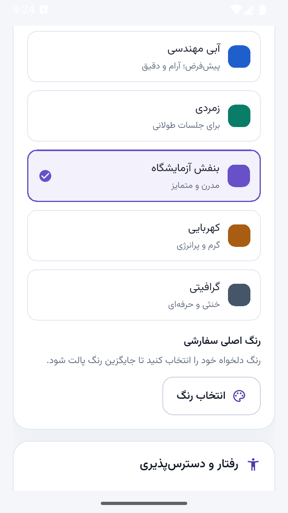
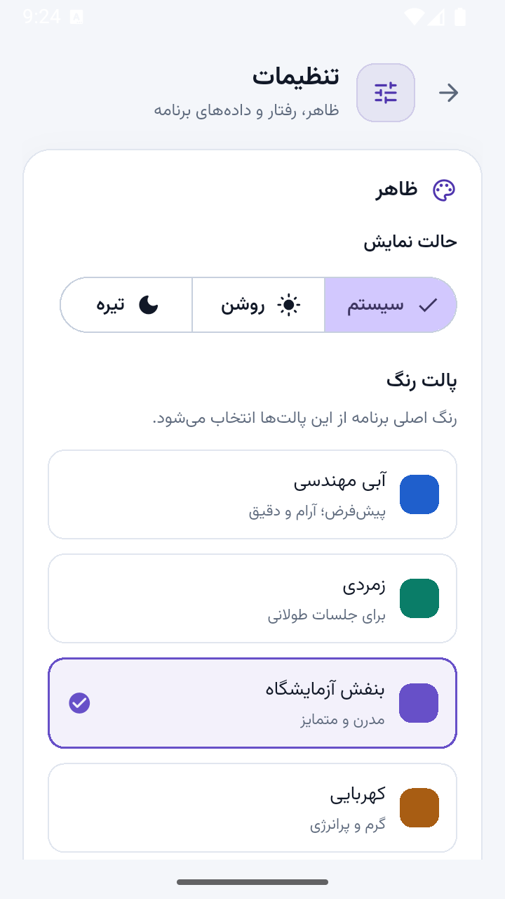

<<<<<<< HEAD
# ⚡ Logic Lab

> آزمایشگاه منطق — شبیه‌ساز آفلاین و فارسی‌زبان مدارهای دیجیتال

[](https://flutter.dev)
[](https://dart.dev)
[](LICENSE)
[](https://github.com/ScrollBots/Logic-Lab/releases)
[](https://github.com/ScrollBots/Logic-Lab/actions/workflows/ci.yml)
[](https://github.com/ScrollBots/Logic-Lab/releases)

---

## 🎯 در یک نگاه

<span dir="ltr">**Logic Lab**</span> یک شبیه‌ساز مدارهای دیجیتال است که کاملاً **آفلاین** و **فارسی‌زبان** کار می‌کند. بدون نیاز به اینترنت، مدارهای ترکیبی و ترتیبی را طراحی، شبیه‌سازی و تحلیل کنید.

- 🧩 **۸۰+ قطعه** در ۱۲ گروه (گیت‌ها، قطعات حسابی، مالتی‌پلکسرها، دیکودرها، قفل‌ها، فلیپ‌فلپ‌ها، ثبات‌ها و شمارنده‌ها)
- ⚡ **شبیه‌سازی ۴ مرحله‌ای** با پشتیبانی از حالت ترتیبی (فلیپ‌فلپ، ثبات، شمارنده)
- 📊 **جدول حقیقت** خودکار با خروجی CSV
- 🧮 **ابزارهای بولی** — تجزیه، ساده‌سازی و تبدیل عبارت به مدار
- 🎓 **مسیر یادگیری** با درس، چالش و تمرین
- 💾 **ذخیره‌سازی محلی** با SQLite و پشتیبان‌گیری JSON

---

## ✨ ویژگی‌ها

### ویرایشگر مدار
- کشیدن و رها کردن قطعات روی بوم
- اتصال پایه به پایه با پیش‌نمایش سیم
- زوم، پن و شبکهٔ ۲۴ واحدی
- لغو/تکرار (Undo/Redo) نامحدود
- ذخیرهٔ خودکار و بازیابی حالت
- حالت انتخاب گروهی برای حذف چندتایی

### شبیه‌سازی
- سیگنال‌های ۴ حالته: `0`، `1`، `?` (نامشخص)، `Z` (امپدانس بالا)
- تشخیص مدار ترکیبی vs ترتیبی
- گزارش خطاهای اتصال و قطعات نامعتبر
- بازخورد لمسی و بصری

### پروژه‌ها
- ایجاد، ویرایش، تکثیر، تغییر نام و حذف
- وارد/خارج کردن JSON با اعتبارسنجی دقیق
- پشتیبان‌گیری کامل (پروژه‌ها + پیشرفت + تنظیمات)
- جست‌وجو و مرتب‌سازی

### یادگیری
- درس‌های تعاملی از سیگنال دیجیتال تا حافظه و ترتیب
- چالش‌های ساخت مدار با بازخورد
- پیشرفت و XP
- مرجع گیت‌ها

### تنظیمات
- تم روشن/تاریک/سیستم
- پالت رنگ قابل تنظیم
- اندازهٔ فونت
- تنظیمات شبیه‌سازی (سقف تکرار، تأخیر)
- دربارهٔ برنامه

---

## 🧩 کتابخانهٔ قطعات

| گروه | قطعات |
|---|---|
| ورودی و خروجی | ورودی، خروجی، منبع کلاک |
| گیت‌های منطقی | AND، OR، NOT، NAND، NOR، XOR، XNOR، بافر و بافر سه‌حالته |
| گیت‌های چندورودی | AND، OR، NAND، NOR، XOR و XNOR با **۲ تا ۸ ورودی** |
| گیت‌های مرکب | AOI21، AOI22، OAI21، OAI22 |
| قطعات حسابی | نیم‌جمع‌کننده، جمع‌کنندهٔ کامل، نیم‌تفریق‌کننده، تفریق‌کنندهٔ کامل و مقایسه‌گر ۲ بیتی |
| انتخابگرها | MUX 2:1 و 4:1؛ DEMUX 1:2 و 1:4 |
| کدگذار/کدگشا | دیکودر 2→4 و 3→8؛ انکودر 4→2 و 8→3؛ انکودر اولویت‌دار |
| قفل‌ها و فلیپ‌فلپ‌ها | قفل SR، قفل SR دروازه‌دار، قفل D و فلیپ‌فلپ‌های D، T و JK |
| ثبات‌ها و شمارنده‌ها | ثبات ۴ بیتی، ثبات انتقال ۴ بیتی، شمارندهٔ ۴ بیتی و شمارندهٔ بالا/پایین |

تعریف قطعات و پایه‌های آن‌ها در [ComponentSpec](lib/features/editor/domain/component_spec.dart) متمرکز است.

---

## 📸 تصاویر

<table align="center">
  <tr>
    <td align="center"></td>
    <td align="center"></td>
  </tr>
  <tr>
    <td align="center"><sub>محیط اصلی</sub></td>
    <td align="center"><sub>داشبورد</sub></td>
  </tr>
  <tr>
    <td align="center"></td>
    <td align="center"></td>
  </tr>
  <tr>
    <td align="center"><sub>پروژه‌ها</sub></td>
    <td align="center"><sub>تنظیمات</sub></td>
  </tr>
</table>

## 🚀 شروع سریع

### پیش‌نیازها
- [Flutter](https://flutter.dev) 3.29.3
- [Dart](https://dart.dev) 3.7.2
- Android SDK / Java 17 (برای بیلد اندروید)

### اجرا
```bash
git clone https://github.com/ScrollBots/Logic-Lab.git
cd Logic-Lab
flutter pub get
flutter run
```

### بررسی و بیلد
```bash
flutter analyze --no-pub
flutter test --no-pub
flutter build apk --release --no-pub
```

---

## 🏗️ معماری

پروژه به صورت **feature-first** سازمان‌دهی شده:

```
lib/
├── app/          # ریشهٔ برنامه، مسیریابی و پوستهٔ ناوبری
├── core/         # داده، زبان، پوسته، سرویس‌ها و ویجت‌های مشترک
└── features/
    ├── editor/        # domain / application / presentation
    ├── projects/      # مدل، قالب فایل، مخزن و فهرست پروژه‌ها
    ├── truth_table/   # تولید و نمایش جدول حقیقت
    ├── analysis/      # تحلیل و مقایسهٔ مدار
    ├── boolean_tools/ # تجزیه، ساده‌سازی و تبدیل عبارت
    ├── learn/         # درس‌ها، چالش‌ها و پیشرفت
    ├── lab/           # گیت‌های تعاملی و مدارهای آماده
    ├── home/          # داشبورد
    ├── settings/      # ظاهر، رفتار و مدیریت داده
    └── splash/        # صفحهٔ آغازین
```

```
Presentation → Application → Domain
                    ↓
               Repository
```

---

## 🧪 کیفیت و انتشار

| گردش‌کار | زمان اجرا | نتیجه |
|---|---|---|
| [CI](.github/workflows/ci.yml) | push و pull request به `main` | اعتبارسنجی تنظیمات، تست متون انتشار، فرمت Dart، تحلیل و اجرای همهٔ آزمون‌ها |
| [Release](.github/workflows/release.yml) | تگ `v*` یا اجرای دستی | دروازهٔ کیفیت مستقل، سپس ساخت، بررسی و انتشار سه خروجی اصلی |
| [Web preview](.github/workflows/web-preview.yml) | اجرای دستی یا فعال‌سازی | پیش‌نمایش اختیاری، خارج از مسیر انتشار |

---

## 📄 مجوز

کد اصلی و مستندات این پروژه تحت **[MIT License](LICENSE)** ارائه می‌شوند.

فونت‌ها مجوزهای مستقل خود را دارند:

| قلم | کاربرد | مجوز |
|---|---|---|
| [Vazirmatn](https://github.com/rastikerdar/vazirmatn) | رابط فارسی | [SIL OFL 1.1](assets/fonts/OFL.txt) |
| JetBrains Mono | بیت‌ها، شناسه‌ها و عبارت‌ها | [SIL OFL 1.1](assets/fonts/JetBrainsMono-OFL.txt) |

---

<p align="center">
  ساخته شده با ❤️ و Flutter
</p>


=======
# Logic Lab — آزمایشگاه منطق

> مدار بسازید، رفتار آن را ببینید و منطق دیجیتال را با تجربه یاد بگیرید.

**اندروید · کاملاً آفلاین · رابط فارسی · نسخهٔ 1.4.0 · [مجوز MIT](LICENSE)**

Logic Lab یک آزمایشگاه تعاملی برای ساخت و شبیه‌سازی مدارهای منطقی دیجیتال است. از گیت‌های ساده تا فلیپ‌فلپ‌ها، رجیسترها و شمارنده‌ها را روی بوم قرار دهید، ورودی‌ها و کلاک را کنترل کنید و نتیجه را با جدول حقیقت، تحلیل مدار و ابزارهای عبارت بولی بررسی کنید.

برنامه به حساب کاربری، اینترنت یا سرویس ابری نیاز ندارد. پروژه‌ها، پیشرفت یادگیری، تنظیمات و قلم‌ها روی دستگاه نگهداری می‌شوند.

**[دریافت نسخهٔ اندروید](https://github.com/ScrollBots/Logic-Lab/releases/tag/v1.4.0)** · **[یادداشت‌های انتشار](#release-notes)** · **[راهنمای CI و انتشار](.github/CI.md)**

---

**راهنمای مطالعه**

- [نصب و شروع سریع](#getting-started)
- [امکانات برنامه](#features)
- [کتابخانهٔ قطعات](#components)
- [رفتار شبیه‌ساز](#simulation)
- [داده و پشتیبان‌گیری](#data)
- [توسعه و معماری](#development)
- [کنترل کیفیت و انتشار](#quality)
- [محدودیت‌های فعلی](#limitations)
- [یادداشت‌های انتشار](#release-notes)
- [پروانه و قلم‌ها](#licensing)

## نصب و شروع سریع

<a id="getting-started"></a>

### دریافت و نصب

فایل‌های نسخهٔ منتشرشده در [صفحهٔ انتشار 1.3.0](https://github.com/ScrollBots/Logic-Lab/releases/tag/v1.3.0) قرار دارند. برای نصب مستقیم، **APK متناسب با معماری دستگاه** را انتخاب کنید.

| فایل | مناسب برای |
|---|---|
| [app-arm64-v8a-release.apk](https://github.com/ScrollBots/Logic-Lab/releases/download/v1.3.0/app-arm64-v8a-release.apk) | گوشی‌ها و تبلت‌های ARM با معماری ۶۴ بیتی |
| [app-armeabi-v7a-release.apk](https://github.com/ScrollBots/Logic-Lab/releases/download/v1.3.0/app-armeabi-v7a-release.apk) | دستگاه‌های ARM با معماری ۳۲ بیتی |
| [app-x86_64-release.apk](https://github.com/ScrollBots/Logic-Lab/releases/download/v1.3.0/app-x86_64-release.apk) | دستگاه‌ها یا شبیه‌سازهای x86_64 |
| [app-release.aab](https://github.com/ScrollBots/Logic-Lab/releases/download/v1.3.0/app-release.aab) | بستهٔ توزیع اندروید؛ برای نصب مستقیم از APK استفاده کنید |

1. APK را از صفحهٔ انتشار مخزن دریافت کنید.
2. فایل را باز کنید و در صورت درخواست اندروید، اجازهٔ نصب از همان منبع مورد اعتماد را بدهید.
3. پس از نصب، برنامه را با نام **Logic Lab** باز کنید؛ استفاده از آن در حالت هواپیما نیز ممکن است.

> خروجی‌های بخش Actions برای بررسی CI هستند و جای فایل‌های امضاشدهٔ صفحهٔ Release را نمی‌گیرند. برای به‌روزرسانی بدون حذف داده‌ها، شناسهٔ برنامه و کلید امضای نسخهٔ قبلی باید حفظ شوند.

### اولین مدار در چند گام

1. یک پروژه بسازید و ویرایشگر را باز کنید.
2. دو قطعهٔ ورودی، یک گیت `AND` و یک قطعهٔ خروجی روی بوم قرار دهید.
3. پایهٔ خروجی هر ورودی را به یکی از پایه‌های ورودی گیت وصل کنید؛ سپس خروجی گیت را به قطعهٔ خروجی متصل کنید.
4. مقدار ورودی‌ها را تغییر دهید و نتیجه را ببینید: خروجی `AND` فقط وقتی هر دو ورودی `HIGH` باشند، `HIGH` می‌شود.
5. جدول حقیقت را باز کنید تا چهار حالت همین مدار را بررسی کنید؛ پروژه با ذخیرهٔ خودکار نگهداری می‌شود.

اتصال با **زدن پایهٔ خروجی و سپس پایهٔ ورودی** یا **کشیدن خروجی به ورودی** انجام می‌شود. برای مدارهای ترتیبی، کلاک را متصل کنید و از کنترل‌های اجرا، توقف، یک پالس و بازنشانی استفاده کنید.

## امکانات برنامه

<a id="features"></a>

| بخش | آنچه در اختیار دارید |
|---|---|
| ویرایشگر مدار | بوم تعاملی، جست‌وجوی قطعات، اتصال سیم، انتخاب چندتایی، تکثیر، حذف، بازگشت/انجام و ذخیرهٔ خودکار |
| شبیه‌سازی | منطق چهارمقداری، قطعات ترکیبی و ترتیبی، کنترل کلاک و گزارش اتصال‌ها یا مدارهای نامعتبر |
| جدول حقیقت | محاسبه از روی همان مدار، چند خروجی، پالایش نتایج و خروجی CSV |
| تحلیل مدار | تعداد گیت‌ها، عمق مدار، عناصر ترتیبی و مقایسهٔ رفتار دو مدار |
| ابزارهای بولی | تجزیه و ارزیابی عبارت، ساده‌سازی، بررسی هم‌ارزی و تبدیل عبارت به مدار قابل ویرایش |
| یادگیری و آزمایشگاه | مسیر درس‌های کوتاه در ۶ واحد، مرور فاصله‌دار، XP و روزهای پیاپی، مرجع گیت‌ها، مدارهای آماده و چالش‌هایی با ارزیابی بر پایهٔ رفتار واقعی مدار |
| پروژه‌ها و تنظیمات | جست‌وجو و مرتب‌سازی پروژه‌ها، واردسازی/خروجی JSON، پشتیبان‌گیری و شخصی‌سازی ظاهر |

### ویرایشگر مناسب موبایل

- **کار با بوم:** بزرگ‌نمایی با حفظ مرکز نما، جابه‌جایی در مختصات مدار و هم‌ترازی با شبکهٔ ۲۴ واحدی.
- **انتخاب و اتصال:** انتخاب نزدیک‌ترین پایه، پیش‌نمایش سیم هنگام کشیدن و لغو اتصال با رهاکردن روی فضای خالی.
- **ویرایش دقیق:** هر جابه‌جایی واقعی یک گام بازگشت دارد؛ کشیدن بدون حرکت تاریخچه را تغییر نمی‌دهد. برچسب، مقدار اولیه و تعداد ورودی گیت از پنجرهٔ ویژگی‌ها قابل تنظیم‌اند.
- **کنترل‌های واکنش‌گرا:** نوار ابزار شناور با اسکرول افقی، داک وضعیت و سینی قطعات با ارتفاع قابل تغییر، جست‌وجو و فیلتر دسته‌ها.
- **رسم بهینه:** لایه‌های مستقل شبکه، سیم و قطعه با `RepaintBoundary` و محدودکردن رسم به محدودهٔ قابل مشاهده.

### ظاهر، زبان و دسترس‌پذیری

رابط با Material 3، زبان فارسی و جهت راست‌به‌چپ طراحی شده است. ارقام و تاریخ‌های رابط فارسی و جلالی‌اند؛ بیت‌ها، شناسه‌ها و عبارت‌های فنی جهت چپ‌به‌راست و ارقام ASCII خود را حفظ می‌کنند.

پوستهٔ تیره از بوم سرمه‌ای، درخشش و جریان متحرک سیم‌های `HIGH` استفاده می‌کند. پالت، رنگ تأکیدی و رنگ سیگنال‌ها قابل شخصی‌سازی‌اند. خاموش‌کردن انیمیشن و بازخورد لرزشی در تنظیمات رعایت می‌شود و کاهش حرکت سیستم، انیمیشن سیم و پیام ویرایشگر را متوقف می‌کند. کلاک خودکار لرزش تولید نمی‌کند.

کنترل‌های آیکنی و عناصر اصلی رابط دارای برچسب‌های معنایی و راهنما هستند. قلم‌های فارسی و فنی همراه برنامه بسته‌بندی شده‌اند و دانلود نمی‌شوند.

### یادگیری گام‌به‌گام

بخش یادگیری یک مسیر کوتاه و تعاملی است، نه مجموعه‌ای از متن. شش واحد و سیزده درس، از سیگنال دیجیتال تا حافظه و ترتیب، هر کدام سه تا هفت دقیقه‌اند و درس بعدی پس از کامل‌شدن درس قبلی باز می‌شود. مسیر اجباری نیست؛ ویرایشگر و آزمایشگاه همیشه در دسترس‌اند.

| نوع تمرین | کاری که انجام می‌دهید |
|---|---|
| مفهوم | خواندن توضیح کوتاه همراه با پیش‌نمایش مدار واقعی |
| حدس خروجی | پیش‌بینی مقدار خروجی برای یک حالت ورودی |
| جدول حقیقت | کامل‌کردن ردیف‌های جدول از روی رفتار مدار |
| انتخاب | انتخاب گیت، اتصال یا توضیح درست |
| ساخت مدار | ساخت مدار خواسته‌شده در ویرایشگر و ارزیابی آن با شبیه‌ساز واقعی |
| دنبالهٔ حالات | ثبت خروجی قفل، فلیپ‌فلاپ یا شمارنده در هر گام یا لبهٔ کلاک |

- پاسخ نادرست باعث از دست‌دادن پیشرفت نمی‌شود: بازخورد سازنده، دلیل، راهنما و سپس تلاش دوباره و نمایش راه‌حل در دسترس است.
- **مرور فاصله‌دار قاعده‌محور و شفاف است.** تسلط هر مفهوم از نسبت پاسخ‌های درست همان مفهوم می‌آید، فاصلهٔ مرور پس از هر پاسخ درست دو برابر می‌شود و پاسخ نادرست همان مفهوم را برای همان روز به مرور برمی‌گرداند. هیچ مدل پنهانی وجود ندارد.
- XP، سطح، روزهای پیاپی و هدف روزانهٔ ۴۰ XP انگیزه می‌دهند، اما شکستن زنجیره جریمه‌ای ندارد و محتوایی قفل نمی‌کند.
- وضعیت کامل یادگیری (XP، تسلط، زمان‌بندی مرور و گام‌های هر درس) در SQLite ذخیره و در پشتیبان JSON گنجانده می‌شود. پشتیبان‌های قدیمی‌تر همچنان خوانده می‌شوند.
- واحد «حافظه و ترتیب» وضعیت قفل‌ها، فلیپ‌فلاپ‌ها، شمارنده و رجیستر را با همان موتور شبیه‌ساز ویرایشگر محاسبه می‌کند، نه با پیاده‌سازی جداگانه.

### ابزارهای عبارت بولی

عبارت‌ها از پرانتز، ثابت‌های `0` و `1` و عملگرهای زیر پشتیبانی می‌کنند:

| عملگر | نماد | نام جایگزین |
|---|---|---|
| AND | `&` | `AND` |
| OR | `\|` | `OR` |
| NOT | `!` | `NOT` |
| XOR | `^` | `XOR` |

برای نمونه، عبارت `A & B | A & !B` به `A` ساده می‌شود و می‌توان آن را به مدار تبدیل کرد یا با یک مدار ذخیره‌شده مقایسه کرد.

- ارزیابی و جدول حقیقت تا **۸ متغیر** پشتیبانی می‌شوند؛ خطای عبارت همراه با موقعیت آن گزارش می‌شود.
- ساده‌سازی بر پایهٔ کوئین–مک‌کلاسکی و جست‌وجوی پوشش است. نتیجه فقط پس از بررسی هم‌ارزی در همهٔ حالت‌ها «دقیق» برچسب می‌خورد.
- حذف متغیر بی‌اثر مجاز است، اما عبارت ساده‌شده نباید متغیر تازه‌ای وارد کند.
- برای بیش از **۶ متغیر**، ابزار ادعای «حداقل قطعی» نمی‌کند.

## کتابخانهٔ قطعات

<a id="components"></a>

| گروه | قطعات |
|---|---|
| ورودی و خروجی | ورودی، خروجی، منبع کلاک |
| گیت‌های منطقی | AND، OR، NOT، NAND، NOR، XOR، XNOR، بافر و بافر سه‌حالته |
| گیت‌های چندورودی | AND، OR، NAND، NOR، XOR و XNOR با **۲ تا ۸ ورودی**؛ XOR/XNOR بر پایهٔ زوجیت |
| گیت‌های مرکب | AOI21، AOI22، OAI21، OAI22 |
| قطعات حسابی | نیم‌جمع‌کننده، جمع‌کنندهٔ کامل، نیم‌تفریق‌کننده، تفریق‌کنندهٔ کامل و مقایسه‌گر ۲ بیتی |
| انتخابگرها | MUX ‏2:1 و ‏4:1؛ DEMUX ‏1:2 و ‏1:4 |
| کدگذارها | دیکودر ‏2→4 و ‏3→8؛ انکودر ‏4→2 و ‏8→3؛ انکودر اولویت‌دار |
| قفل‌ها و فلیپ‌فلپ‌ها | قفل SR، قفل SR دروازه‌دار، قفل D و فلیپ‌فلپ‌های D، T و JK |
| رجیسترها و شمارنده‌ها | رجیستر ۴ بیتی، رجیستر انتقال ۴ بیتی، شمارندهٔ ۴ بیتی و شمارندهٔ بالا/پایین |

تعریف قطعات و پایه‌های آن‌ها در رجیستری [ComponentSpec](lib/features/editor/domain/component_spec.dart) متمرکز است. قطعات چندخروجی، شمارهٔ پایهٔ مبدأ را در سیم‌ها حفظ می‌کنند تا شبیه‌ساز، بوم و جدول حقیقت خروجی درست را بخوانند.

## رفتار شبیه‌ساز

<a id="simulation"></a>

### سیگنال‌ها و قواعد اتصال

| سیگنال | معنی |
|---|---|
| `LOW` / `0` | صفر منطقی |
| `HIGH` / `1` | یک منطقی |
| `UNKNOWN` / `?` | مقدار قابل تعیین نیست |
| `Z` | امپدانس بالای خروجی سه‌حالتهٔ غیرفعال |

`UNKNOWN` به صفر تبدیل نمی‌شود و با `Z` یکسان نیست. نتیجه از مقدارهای قابل اثبات به دست می‌آید: برای مثال، `AND` با یک ورودی `LOW` نتیجهٔ `LOW` دارد، حتی اگر ورودی دیگری نامشخص باشد؛ `OR` با یک ورودی `HIGH` نیز `HIGH` است.

- سیم فقط از **خروجی به ورودی** متصل می‌شود؛ هر ورودی حداکثر یک سیم می‌پذیرد و هر خروجی می‌تواند چند شاخه داشته باشد.
- پایه‌های نامعتبر، اتصال‌های تکراری، ورودی‌های متصل‌نشده و نبودن قطعهٔ خروجی گزارش می‌شوند. قطعی‌بودن یک سیگنال به معنی معتبر بودن کل مدار نیست.
- چرخهٔ کاملاً ترکیبی نامعتبر است و گره‌های درون آن نامشخص گزارش می‌شوند.
- بازخورد از مسیر یک عنصر حالت‌دار، مانند `Q → NOT → D`، با چرخهٔ ترکیبی تفاوت دارد و مجاز است؛ بازخورد ناپایدار جداگانه گزارش می‌شود.

### حالت ترتیبی و گام شبیه‌سازی

قفل‌ها به سطح فعال حساس‌اند؛ فلیپ‌فلپ‌ها، رجیسترها و شمارنده‌ها ورودی را در **لبهٔ بالاروندهٔ کلاک** ثبت می‌کنند. دادهٔ نامشخص می‌تواند در حالت ترتیبی باقی بماند و کلاک نامشخص یا معلق لبهٔ معتبر تولید نمی‌کند.

هر گام موتور چهار مرحله دارد:

1. **اعتبارسنجی:** بررسی گره‌ها، پایه‌ها، اتصال‌ها و چرخه‌های ترکیبی.
2. **محاسبهٔ سیگنال:** ارزیابی منطق ترکیبی با ترتیب توپولوژیک، بر اساس حالت ترتیبی ابتدای گام.
3. **به‌روزرسانی حالت:** خواندن سیگنال‌های محاسبه‌شده و ثبت ورودی عناصر حالت‌دار.
4. **نشست:** تکرار لازم تا پایدارشدن حالت، با سقف محدود برای جلوگیری از اجرای بی‌پایان؛ نتیجه متعلق به حالت نهایی همان گام است.

### جدول حقیقت و کارایی

جدول حقیقت با اجرای **همان شبیه‌ساز** برای هر ترکیب ورودی ساخته می‌شود، نه با پیاده‌سازی جداگانهٔ منطق گیت‌ها. سقف محاسبه از میان **۶۴، ۲۵۶ یا ۱۰۲۴ ردیف** قابل انتخاب است و عبور از آن با پیام توضیحی رد می‌شود.

در مدارهای ترتیبی، هر ردیف از **وضعیت اولیهٔ عناصر** محاسبه می‌شود؛ این جدول جای نمودار زمانی را نمی‌گیرد. تولید جدول روی اندروید با `compute` در isolate انجام می‌شود و صفحه وضعیت بارگذاری دارد.

> شبیه‌ساز اصلی ویرایشگر همچنان همگام است. هنگام کشیدن قطعه شبیه‌سازی انجام نمی‌شود و نتیجه در پایان حرکت به‌روزرسانی می‌شود؛ انتقال محاسبهٔ جدول حقیقت به isolate به معنی انتقال کل موتور نیست.

## داده و پشتیبان‌گیری

<a id="data"></a>

| داده | محل یا قالب نگهداری |
|---|---|
| پروژه‌ها و پیشرفت یادگیری | SQLite محلی |
| ظاهر و رفتار برنامه | SharedPreferences |
| فایل قابل‌حمل پروژه | JSON نسخه‌دار با `format: logic-lab-project` و `version: 1` |
| پشتیبان کامل | JSON با `format: logic-lab-backup`؛ شامل پروژه‌ها، پیشرفت و تنظیمات |
| جدول حقیقت | خروجی CSV |

فهرست پروژه‌ها جست‌وجو و مرتب‌سازی بر اساس نام، زمان ایجاد یا آخرین ویرایش را پشتیبانی می‌کند. واردسازی و اشتراک‌گذاری فایل با انتخاب و درخواست کاربر انجام می‌شود.

**فایل پروژه پیش از جایگزینی اعتبارسنجی می‌شود.** قالب نامعتبر، نسخهٔ پشتیبانی‌نشده، شناسهٔ تکراری، سیم با گرهٔ گم‌شده یا پایهٔ نامعتبر و مقدارهای بدنوع رد می‌شوند. فایل‌های بیش از **۴ مگابایت** پیش از تجزیه کنار گذاشته می‌شوند؛ واردسازی ناموفق پروژهٔ در حال کار را تغییر نمی‌دهد.

مدارهای قدیمی با فیلدهای اختیاری همچنان قابل خواندن‌اند. نوع قطعهٔ ناشناخته به‌صورت «پشتیبانی‌نشده» بارگذاری و گزارش می‌شود. ردیف‌های خراب پایگاه‌داده نادیده گرفته می‌شوند و حذف همهٔ داده‌ها نیاز به تأیید صریح دارد.

> داده‌ها با حساب یا فضای ابری همگام نمی‌شوند. پیش از حذف برنامه یا جابه‌جایی دستگاه، از بخش مدیریت داده پشتیبان بگیرید و فایل را خارج از فضای برنامه نگه دارید.

## توسعه و معماری

<a id="development"></a>

### زنجیرهٔ ابزار

| مورد | تنظیم فعلی |
|---|---|
| Flutter | `3.29.3` |
| Dart | `3.7.2` |
| Java در CI | Temurin `17` |
| Runner در CI | `ubuntu-24.04` |
| نسخهٔ منبع | `1.3.0+4` |
| شناسهٔ اندروید | `ir.logiclab.logic_lab` |
| زبان و رابط | فارسی `fa_IR`، راست‌به‌چپ، Material 3 |

نسخه و وابستگی‌ها در [pubspec.yaml](pubspec.yaml) تعریف شده‌اند. ابزارها و بسته‌ها باید با این زنجیرهٔ ثابت سازگار باشند؛ به‌روزرسانی مستقل یک بسته به نسخه‌ای با نیازمندی Dart جدیدتر، لزوماً قابل استفاده نیست.

| لایه | ابزارهای اصلی |
|---|---|
| رابط و مدیریت وضعیت | Flutter، `provider` و `flutter_localizations` |
| ماندگاری | `sqflite` و `shared_preferences` |
| فایل و اشتراک‌گذاری | `file_picker`، `path_provider`، `path` و `share_plus` |
| بازکردن پیوندها | `url_launcher` |
| تحلیل و آزمون | `flutter_lints`، `flutter_test` و `yaml` برای اعتبارسنجی CI |

### ساختار پروژه

معماری **feature-first** است؛ رابط، کنترلر، منطق دامنه و ماندگاری از یکدیگر جدا هستند. هستهٔ شبیه‌ساز و ابزارهای بولی با Dart خالص نوشته شده‌اند تا بدون درخت ویجت قابل آزمون باشند.

```text
lib/
├── app/               ریشهٔ برنامه، راه‌اندازی و پوستهٔ ناوبری
├── core/              داده، زبان، پوسته، سرویس‌ها و ویجت‌های مشترک
└── features/
    ├── editor/        domain / application / presentation
    ├── projects/      مدل، قالب فایل، مخزن و فهرست پروژه‌ها
    ├── truth_table/   تولید و نمایش جدول حقیقت
    ├── analysis/      تحلیل و مقایسهٔ مدار
    ├── boolean_tools/ تجزیه، ساده‌سازی و تبدیل عبارت
    ├── learn/         درس‌ها، چالش‌ها و پیشرفت
    ├── lab/           گیت‌های تعاملی و مدارهای آماده
    ├── home/          داشبورد
    ├── settings/      ظاهر، رفتار و مدیریت داده
    └── splash/        صفحهٔ آغازین
```

```text
Presentation → Application → Domain
                    ↓
                Repository
```

ماندگاری از راه رابط‌های `ProjectRepository` و `LearningProgressRepository` انجام می‌شود. پیاده‌سازی SQLite برای اندروید و پیاده‌سازی‌های درون‌حافظه‌ای برای آزمون‌ها در دسترس‌اند.

### اجرای محلی، در صورت نیاز

برای توسعهٔ اندروید به Flutter سازگار، Java، Android SDK و دستگاه یا شبیه‌ساز آماده نیاز دارید:

```bash
git clone https://github.com/ScrollBots/Logic-Lab.git
cd Logic-Lab
flutter pub get
flutter run
```

**مسیر اصلی بررسی و بیلد، GitHub Actions است.** اجرای محلی آزمون‌ها الزامی نیست؛ اگر برای توسعه به آن نیاز داشتید:

```bash
flutter analyze --no-pub
flutter test --no-pub
flutter build apk --release --no-pub
```

برای امضای محلی، از الگوی [android/key.properties.example](android/key.properties.example) و keystore خود استفاده کنید. بدون تنظیمات امضای release، Gradle از **کلید debug** استفاده می‌کند؛ چنین خروجی‌ای انتشار رسمی نیست. کوچک‌سازی کد و منابع با R8 فعال است.

> keystore، رمزها و فایل تنظیمات واقعی امضا را وارد مخزن نکنید. برای به‌روزرسانی نسخهٔ نصب‌شده، همان کلید قبلی را حفظ کنید.

## کنترل کیفیت و انتشار

<a id="quality"></a>

### گردش‌کارها

| گردش‌کار | زمان اجرا | نتیجه |
|---|---|---|
| [CI](.github/workflows/ci.yml) | push و pull request به `main` یا اجرای دستی | اعتبارسنجی تنظیمات، تست متن انتشار، فرمت Dart، تحلیل ایستا و همهٔ تست‌های واحد/ویجت؛ سپس APK دیباگ و AAB آزمایشی |
| [Release](.github/workflows/release.yml) | تگ `v*` یا اجرای دستی با نسخهٔ جدید | دروازهٔ کیفیت مستقل؛ سپس ساخت، بررسی و انتشار سه APK امضاشده و یک AAB |
| [Web preview](.github/workflows/web-preview.yml) | اجرای دستی یا فعال‌بودن `ENABLE_WEB_PREVIEW=true` روی push | پیش‌نمایش اختیاری، خارج از مسیر محصول و انتشار اندروید |

```text
اعتبارسنجی تنظیمات و متن انتشار
              ↓
       فرمت، تحلیل و آزمون‌ها
              ↓ فقط در صورت موفقیت
          بیلد اندروید
              ↓ فقط در Release
  بررسی هویت، نسخه و امضا → انتشار
```

شکست هر بررسی کیفیت، بیلد یا انتشار بعدی را متوقف می‌کند. صفحهٔ **Summary** نتیجهٔ واقعی مراحل و لینک خروجی‌ها را نمایش می‌دهد و موفقیت، شکست، اجرا‌نشدن و لغو را از یکدیگر جدا می‌کند. artifactهای CI شامل گزارش پوشش، APK دیباگ و AAB هستند و ۱۴ روز نگهداری می‌شوند.

[Dependabot](.github/dependabot.yml) به‌روزرسانی‌های minor و patch بسته‌های Dart را گروه‌بندی می‌کند؛ محدودیت‌های سازگاری با SDK ثابت حفظ شده‌اند.

### حوزه‌های آزمون

| حوزه | نمونهٔ مرجع |
|---|---|
| گیت‌ها و قطعات حسابی | [جدول حقیقت گیت‌ها](test/features/editor/gate_truth_tables_test.dart)، [حسابی و انتخابگرها](test/features/editor/arithmetic_and_selection_test.dart) |
| حالت ترتیبی و خروجی موتور | [عناصر ترتیبی](test/features/editor/sequential_components_test.dart)، [سازگاری نتیجه](test/features/editor/simulation_result_consistency_test.dart) |
| تعامل و چیدمان موبایل | [بوم](test/features/editor/circuit_canvas_test.dart)، [کنترلر](test/features/editor/circuit_editor_controller_test.dart)، [چیدمان](test/features/editor/editor_ui_layout_test.dart) |
| جدول حقیقت و عبارت بولی | [جدول حقیقت](test/features/truth_table/truth_table_test.dart)، [راستی‌آزمایی کمینه‌ساز](test/features/boolean_tools/boolean_minimization_verification_test.dart) |
| داده و تنظیمات | [واردسازی و خروجی](test/features/projects/import_export_test.dart)، [پشتیبان](test/features/settings/backup_codec_test.dart)، [ماندگاری تنظیمات](test/features/settings/settings_persistence_test.dart) |
| یادگیری و نسخه | [ارزیابی چالش‌ها](test/features/learn/challenge_validator_test.dart)، [تمرین‌ها](test/features/learn/lesson_models_test.dart)، [وضعیت و مرور](test/features/learn/learning_state_test.dart)، [کنترلر](test/features/learn/learning_controller_test.dart)، [تجربهٔ موبایل](test/features/learn/learning_home_test.dart)، [هماهنگی نسخه](test/core/app_info_test.dart) |
| کارایی و متن انتشار | [محافظ رشد شبیه‌سازی](test/features/editor/simulation_benchmark_test.dart)، [تولید یادداشت انتشار](tool/test_release_notes.py) |

جدول‌های مرجع در [test/support/circuit_test_support.dart](test/support/circuit_test_support.dart) مستقل از تعریف قطعات نوشته شده‌اند. کمینه‌ساز بولی نیز برای همهٔ توابع سه‌متغیره با جست‌وجوی مرجع مستقل مقایسه می‌شود. CI همهٔ آزمون‌های موجود را اجرا می‌کند، نه فقط نمونه‌های جدول بالا.

### نسخه و متن انتشار

- نسخه در [pubspec.yaml](pubspec.yaml) نگهداری و در [AppInfo](lib/core/app_info.dart) آینه می‌شود؛ [tool/set_version.dart](tool/set_version.dart) آن‌ها را هماهنگ می‌کند و آزمون اختلاف را رد می‌کند.
- نسخهٔ صفحهٔ «درباره» با نقطه‌های استاندارد، مانند `1.3.0`، نمایش داده می‌شود و شمارهٔ build جداست. شمارهٔ build بستهٔ انتشار از شمارهٔ اجرای گردش‌کار Release گرفته می‌شود.
- پیش از انتشار، در بخش زیر یک عنوان `### نسخهٔ 1.4.0` با فهرست تغییرات واقعی همان نسخه اضافه کنید؛ برای پیش‌انتشار، پسوند نیز لازم است، مانند `1.4.0-rc.1`.
- [tool/release_notes.py](tool/release_notes.py) متن فارسی **همان نسخه** را استخراج و راهنمای نصب و توضیح کنترل کیفیت را اضافه می‌کند. یادداشت گم‌شده یا بدون تغییرات معنادار، انتشار را پیش از بازیابی امضا و بیلد متوقف می‌کند.
- Release شناسه، نام لانچر، نسخه، شمارهٔ build و امضای APKها و امضای AAB را بررسی می‌کند. فهرست خودکار تغییرات GitHub به متن فارسی افزوده می‌شود؛ انتشار قبلی بازنویسی نمی‌شود.

تنظیم چهار Secret امضا، مراحل انتشار، اجرای دستی و عیب‌یابی در **[راهنمای CI و انتشار](.github/CI.md)** آمده است. push معمولی به `main` فقط CI را اجرا می‌کند و به‌تنهایی نسخهٔ جدید منتشر نمی‌کند.

## محدودیت‌های فعلی

<a id="limitations"></a>

- **محصول اصلی اندروید است.** وب فقط پیش‌نمایش اختیاری دارد؛ داده‌های آن درون‌حافظه‌ای‌اند و ماندگاری SQLite اندروید را ندارند.
- فرکانس کلاک قابل تنظیم، نمودار زمانی، خروجی PNG/PDF و IC سفارشی هنوز پیاده‌سازی نشده‌اند.
- آزمون تعیین سطح، واحدهای ماشین حالت و تمرین‌های «تعمیر مدار خراب»، «ساده‌سازی عبارت» و «تطبیق عبارت با مدار» هنوز در مسیر یادگیری نیستند.
- سقف جدول حقیقت و محدودیت متغیرهای ابزار بولی برای کنترل هزینهٔ محاسبه اعمال می‌شوند.
- موفقیت تست‌های واحد/ویجت و بیلد CI، تأیید لمس، کارایی یا لرزش روی گوشی واقعی نیست؛ بررسی دستگاه واقعی جداگانه لازم است.

## یادداشت‌های انتشار

<a id="release-notes"></a>

این بخش تاریخچهٔ تغییرات هر نسخه است. آمار آزمون و اندازه‌گیری‌های قدیمی به همان انتشار مربوط‌اند، نه وضعیت فعلی پروژه.

### نسخهٔ ۱٫۴٫۲

* **بررسی به‌روزرسانی درون‌برنامه‌ای:** هنگام انتشار نسخهٔ جدید در GitHub، برنامه یک بار در هر نشست آخرین انتشار پایدار را بررسی می‌کند و اگر نسخهٔ تازه‌تری باشد پیغام آپدیت با دو دکمهٔ «بعداً» و «دانلود» نشان می‌دهد؛ دکمهٔ دانلود فایل نصب universal همان آخرین نسخه را در مرورگر باز می‌کند و «بعداً» همان نسخه را برای بعد نگه می‌دارد.
* **اصلاح دکمهٔ «پاک کردن جست‌وجو»:** فراخوانی `setState` درست انجام نمی‌شد و عبارت جست‌وجو پاک نمی‌شد؛ اکنون با زدن دکمه، فیلتر جست‌وجو واقعاً پاک می‌شود.
* **پایداری آزمون‌های ناوبری:** عنوان فارسی «مدارهای من» کلید یکتای `projects-page-title` گرفت تا یافتن‌گرهای آزمون میان نوار آپ‌بار و بدنهٔ صفحه مبهم نباشند؛ همهٔ ۳۸۹ آزمون سبز است.
* **کیفیت کد:** رفع همهٔ هشدارهای تحلیل ایستا، فرمت‌بندی یکنواخت Dart در `lib` و `test` و `tool`، و حذف بررسی‌کنندهٔ تکراری و شبیه‌سازی‌شدهٔ آپدیت.

### نسخهٔ ۱٫۴٫۰

* **تماشای صفحه تنظیمات:** حذف بخش «به‌روزرسانی» از صفحه تنظیمات و اضافه کردن دکمه «بازگشت» در نوار آپ‌بار که امکان بازگشت به صفحه قبلی را فراهم می‌کند.
* **حذف گروهی مدارات:** اضافه کردن قابلیت «انتخاب همه» و حذف گروهی مدارها در صفحه «مدارها من». کاربران می‌توانند چندین مدار را انتخاب کرده و در یک عملیات واحد حذف کنند، بدون نیاز به حذف تک‌تک آن‌ها. حالت انتخاب نمایش‌دهنده چک‌باکس در mỗi کارت مدار و دکمه «حذف X مدار انتخاب شده» در نوار آپ‌بار ارائه می‌دهد.
* **.Refinement‌های طراحی:**頭 redesign صفحه_header با ساعت در سمت چپ، Identité-centered «Logic Lab / آزمایشگاه منطق» و دکمه تنظیمات در سمت راست؛ ناوبری پایین با چهار تب (خانه، مدارها، آزمایشگاه، آموزش) و انیمیشن morbid نرم بین تب‌ها.
* **افزایش پوشش تست:** افزودن ۵ آزمون جدید برای تایید heading header، identification centered، clock-left/settings-right، settings button navigation و تعداد 4 destination در ناوبری.

### نسخهٔ ۱٫۳٫۰

* **مسیر یادگیری فعال:** شش واحد و سیزده درس کوتاه از سیگنال دیجیتال تا حافظه و ترتیب، با پیش‌نیاز درس قبلی، کارت «ادامهٔ یادگیری»، نقشهٔ واحدها و مرور دوبارهٔ درس‌های کامل‌شده.
* **تمرین به‌جای متن:** مفهوم، حدس خروجی، جدول حقیقت، انتخاب گیت یا توضیح، ساخت مدار در ویرایشگر و دنبالهٔ حالات؛ ارزیابی ساخت مدار با همان شبیه‌ساز و همان اعتبارسنج چالش‌ها انجام می‌شود.
* **بازخورد سازنده:** پاسخ درست یا نادرست با دلیل، راهنمای گام‌به‌گام، تلاش دوباره و نمایش راه‌حل؛ پاسخ اشتباه پیشرفت را از بین نمی‌برد.
* **واحد تازهٔ «حافظه و ترتیب»:** قفل D شفاف و نگه‌دارنده، قفل SR، فلیپ‌فلاپ‌های D و T و بیت‌های شمارندهٔ واقعی؛ حالت هر گام با `stepClock` شبیه‌ساز محاسبه می‌شود و پورت‌های EN، CLK و RST درست بسته می‌شوند.
* **مرور فاصله‌دار شفاف:** تسلط هر مفهوم از نسبت پاسخ‌های درست می‌آید، فاصلهٔ مرور پس از هر پاسخ درست دو برابر می‌شود و مفهوم ضعیف یا سررسیده در «مرور هوشمند» برمی‌گردد؛ بدون مدل پنهان.
* **انگیزهٔ بدون فشار:** XP، سطح، روزهای پیاپی، هدف روزانهٔ ۴۰ XP و آمار جلسه؛ شکستن زنجیره جریمه‌ای ندارد و هیچ درسی به‌خاطر آن قفل نمی‌شود.
* **ماندگاری و پشتیبان:** وضعیت کامل یادگیری در SQLite ذخیره و در پشتیبان JSON صادر/بازیابی می‌شود؛ پشتیبان‌های قدیمی‌تر همچنان خوانده می‌شوند و پیشرفت قبلی حفظ می‌شود.
* **راهنما و مرجع:** راهنمای اولین اجرا، توضیح نحوهٔ کار مرور و مسیر، مرجع گیت‌های تعاملی و تمرین آزاد در دسترس‌اند.
* **اصلاحات:** سیم‌کشی تمرین `A·B + A·B̅` (ورودی NOT به B̅ اصلاح شد)، جلوگیری از سرریز کارت ادامه و دکمه‌های صفحهٔ خانه در عرض ۳۶۰ پیکسل، و پایدارسازی آزمون‌های ویجت روی صفحه‌های باریک.
* **آزمون:** مجموعهٔ آزمون‌ها به ۳۳۶ آزمون رسید؛ مدل تمرین‌ها، وضعیت و مرور، کنترلر، ماندگاری، بازسازی پشتیبان و اجرای کامل درس لچ روی صفحهٔ کوچک پوشش دارند.

### نسخهٔ ۱٫۲٫۰

* **تعامل بوم:** اصلاح drag در zoom، حفظ مرکز بزرگ‌نمایی، شبکهٔ ۲۴ واحدی و تاریخچهٔ دقیق بازگشت/انجام؛ حرکت‌های کوچک دیگر هنگام هم‌ترازی گم نمی‌شوند.
* **اتصال:** کشیدن خروجی به ورودی با پیش‌نمایش سیم، انتخاب نزدیک‌ترین پایه و پشتیبانی صحیح از شمارهٔ خروجی ماژول‌ها؛ رهاکردن روی فضای خالی اتصال را لغو می‌کند و اتصال ردشده پیام خطایش را نگه می‌دارد.
* **کارایی:** لایه‌های مستقل رسم و `RepaintBoundary`، رسم فقط محدودهٔ قابل مشاهده، محاسبهٔ خطی انشعاب و تولید جدول حقیقت در isolate روی اندروید.
* **موبایل:** نوار ابزار شناور، داک واکنش‌گرا و سینی قابل تغییر ارتفاع با جست‌وجو، فیلتر دسته‌ها و رعایت صفحه‌کلید.
* **ظاهر و دسترس‌پذیری:** بوم تیرهٔ سرمه‌ای، درخشش و جریان HIGH، حفظ رنگ سفارشی و haptic وابسته به تنظیمات؛ کاهش حرکت سیستم رعایت می‌شود.
* **اصلاحات:** انتخاب ۲ تا ۸ ورودی گیت، بدنهٔ مناسب گیت‌های بلند، نمایش درست خروجی پایهٔ صفر در جدول حقیقت، خواندن مقاوم تنظیمات/JSON/پشتیبان و هماهنگی نسخهٔ بسته و صفحهٔ درباره.
* **CI:** شکست فرمت، تحلیل یا هر تست جلوی بیلد و انتشار را می‌گیرد؛ Release گیت کیفیت مستقل دارد.

این ارتقا تا P3 است؛ فرکانس کلاک قابل تنظیم، نمودار زمانی، خروجی PNG/PDF و IC سفارشی هنوز پیاده‌سازی نشده‌اند.
تست‌های واحد/ویجت و بیلد در CI اجرا می‌شوند؛ بررسی لمس، عملکرد و haptic روی دستگاه واقعی اندروید جداگانه لازم است.

### نسخهٔ ۱٫۱٫۰

**اصلاح‌شده**

* **مدارهای ترتیبی مقدار اشتباه می‌گرفتند.** اگر داده یا کلاک یک فلیپ‌فلپ، رجیستر یا شمارنده از یک گیت
  می‌آمد، آن گیت *بعد* از خودِ فلیپ‌فلپ ارزیابی می‌شد؛ در نتیجه ورودی UNKNOWN خوانده و مقدار بی‌معنایی
  ذخیره می‌شد. موتور اکنون یک گام شبیه‌سازی چهارمرحله‌ای صریح (اعتبارسنجی ← سیگنال‌ها ← حالت ←
  نشست) اجرا می‌کند و همیشه مقدار نشسته را ثبت می‌کند.
* **مقایسه‌گر ۲ بیتی** برای اعداد برابر هم «بزرگ‌تر» گزارش می‌کرد. اکنون «بزرگ‌تر» از قرضِ `b − a` به
  دست می‌آید، نه از «نه کمتر».
* **ساده‌ساز بولی** نتیجه‌های معتبر را دور می‌ریخت. کمینه‌سازی‌ای که یک متغیر بی‌ربط را حذف می‌کرد (برای
  نمونه `A & B | A & !B` → `A`) رد می‌شد و ابزار اصلاً نتیجه‌ای نشان نمی‌داد.
* **ویرایشگر** بازخورد ترتیبی معتبر را رد می‌کرد. اتصالی که حلقه‌ای از راه فلیپ‌فلپ می‌بندد
  (`Q → NOT → D`) مانند چرخهٔ ترکیبی مسدود می‌شد.
* **قفل‌ها** یک گام عقب ارزیابی می‌شدند و بازخوردِ حول قفل به‌عنوان مدار نامعتبر گزارش می‌شد.
* **حالت ترتیبی** توانایی نمایش «نامشخص» را نداشت. گرفتن یک خط دادهٔ معلق اکنون خروجی نامشخص می‌دهد،
  نه صفری خاموش.
* **واردسازی** فایل‌های خراب را قبول می‌کرد. فایل پروژه‌ای با سیمِ آویزان، ایندکس پایهٔ ناممکن یا
  شناسهٔ تکراری اکنون با پیامی خوانا رد می‌شود و فایل‌های بزرگ‌تر از ۴ مگابایت پیش از تجزیه کنار
  گذاشته می‌شوند.
* **مشکلات چیدمان در صفحه‌های کوچک.** سربرگ ابزار عبارت بولی و عنوان دسته‌های سینی قطعات فشرده یا
  تکراری نشان داده می‌شدند؛ هر دو اصلاح شدند و با آزمون‌های ویجت پوشش دارند.

**بهبود یافته**

* هنگام کشیدن یک قطعه دیگر مدار شبیه‌سازی نمی‌شود — نتیجه یک‌بار هنگام رها کردن قطعه به‌روزرسانی
  می‌شود و این واکنش‌گرایی مدارهای بزرگ را حفظ می‌کند.
* جست‌وجوی گره اکنون O(1) است و مرتب‌سازی توپولوژیک دیگر صف خود را جابه‌جا نمی‌کند، بنابراین مدارهای
  بزرگ به‌طور قابل اندازه‌گیری سریع‌تر ارزیابی می‌شوند (حدود ۲۰٪ زمان کمتر برای زنجیرهٔ ۲۰۰ گیت در
  VM دیباگ).
* حالت امپدانس بالا (`Z`) نماد مستقل خود را کنار مقدار خروجی دارد و جدول حقیقت توضیح می‌دهد که مدار
  با عناصر ترتیبی از وضعیت اولیه محاسبه می‌شود.
* دو تشخیص تازه: کلاک نامشخص و بازخورد ناپایدار، به‌جای سکوت، گزارش می‌شوند.

**راستی‌آزمایی‌شده**

* مجموعهٔ آزمون‌ها از ۱۴۹ به ۲۳۳ آزمون رشد کرد: جدول حقیقت کامل در برابر پیاده‌سازی‌های مرجع مستقل،
  آزمون عناصر ترتیبی در چند لبهٔ متوالی، بررسی مستقل کمینه‌ساز بولی و بنچمارکی که از بازگشت به
  جست‌وجوی درجه‌دو جلوگیری می‌کند.

## پروانه و قلم‌ها

<a id="licensing"></a>

کد اصلی و مستندات این پروژه تحت **[MIT License](LICENSE)** ارائه می‌شوند. این مجوز استفاده، تغییر و بازتوزیع، از جمله استفادهٔ تجاری، را با حفظ اعلان حق نشر و متن مجوز اجازه می‌دهد. نرم‌افزار بدون ضمانت ارائه می‌شود.

MIT فقط به آثار اصلی پروژه مربوط است؛ قلم‌ها، Flutter و وابستگی‌های شخص ثالث مجوزهای مستقل خود را حفظ می‌کنند و تحت MIT باز‌مجوزدهی نمی‌شوند. هنگام بازتوزیع، متن مجوزها و اعلان‌های لازم آن‌ها را حفظ کنید. برای اجزای مشمول MPL-2.0، اگر آن‌ها را توزیع می‌کنید، الزامات دسترسی به کد منبع همان اجزا نیز باید رعایت شود.

| قلم | کاربرد | پروانه |
|---|---|---|
| [Vazirmatn](https://github.com/rastikerdar/vazirmatn) | رابط فارسی | [SIL Open Font License 1.1](assets/fonts/OFL.txt) |
| JetBrains Mono | بیت‌ها، شناسه‌ها و عبارت‌های فنی | [SIL Open Font License 1.1](assets/fonts/JetBrainsMono-OFL.txt) |
>>>>>>> feat: verify in-app update prompt and prepare v1.4.2 release notes
